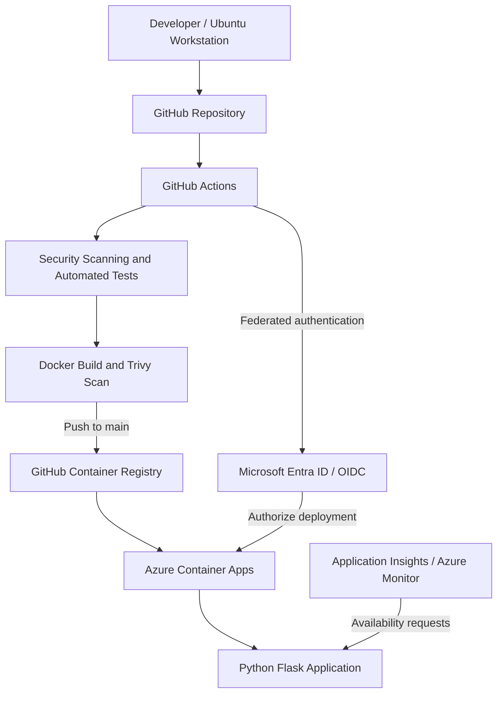

# DevSecOps Lab

A hands-on engineering project implementing a containerized application delivery pipeline with automated security checks, infrastructure as code, cloud deployment, and operational monitoring.

**Status:** Deployment and monitoring validated. Infrastructure may be decommissioned to minimize ongoing cloud costs.

## Overview

This project demonstrates the design, implementation, and operation of a small cloud-hosted application using DevSecOps practices.

A Python Flask application is packaged as a Docker container and delivered through GitHub Actions to Microsoft Azure Container Apps.

The deployment pipeline integrates automated testing and multiple security scanning tools. Azure infrastructure is managed through Terraform, with state stored remotely in Azure Blob Storage.

The objective was to gain practical experience with the complete application delivery lifecycle, from local development through deployment and monitoring.

## Architecture

The diagram is a logical representation of the delivery process. It does not represent every Azure networking or monitoring dependency.

For a detailed explanation, see [Architecture](docs/architecture.md).

## Technology Stack

| Category | Technology |
|---|---|
| Development environment | Ubuntu Linux, VS Code, Git |
| Application | Python, Flask, Gunicorn |
| Containerization | Docker |
| Source control | Git, GitHub |
| CI/CD | GitHub Actions |
| Secret scanning | Gitleaks |
| Static application security testing | Semgrep |
| Dependency vulnerability scanning | pip-audit |
| Container vulnerability scanning | Trivy |
| Container registry | GitHub Container Registry |
| Cloud platform | Microsoft Azure |
| Application hosting | Azure Container Apps |
| Infrastructure as code | Terraform |
| Infrastructure state | Azure Blob Storage |
| Cloud authentication | Microsoft Entra ID / OIDC |
| Monitoring | Azure Monitor, Application Insights |

## Application

The application is a small Python Flask service designed to provide a realistic deployment target.

It exposes:

- `/` — Application endpoint
- `/health` — Health-check endpoint

The application runs inside a Docker container and is hosted on Azure Container Apps.

This project focuses primarily on the infrastructure, delivery pipeline, security controls, and operational lifecycle rather than application complexity.

Application source code is available in [`01-first-container/`](01-first-container/).

## CI/CD Pipeline

GitHub Actions automates the following workflow:

1. Check out source code.
2. Scan the repository for exposed secrets using Gitleaks.
3. Perform static application security testing using Semgrep.
4. Install Python dependencies.
5. Audit dependencies for known vulnerabilities using pip-audit.
6. Execute automated tests using Pytest.
7. Build the Docker container image.
8. Scan the image for high- and critical-severity vulnerabilities using Trivy.
9. Publish the image to GitHub Container Registry on pushes to `main`.
10. Authenticate to Azure using OIDC federation.
11. Deploy the image to Azure Container Apps.

Container images are tagged using the Git commit SHA to support traceability between source code and deployed artifacts.

Publishing and deployment steps are restricted to pushes to the main branch.

The pipeline currently uses a single job. Further separation of validation and deployment permissions is identified as a security improvement.

See [Security](docs/security.md).

## Infrastructure as Code

Terraform manages nine Azure resources:

- Resource group
- Log Analytics workspace
- Container Apps environment
- Container App
- Application Insights resource
- Standard availability test
- Monitoring action group
- Availability metric alert
- Container restart metric alert

Terraform uses a remote Azure Blob Storage backend authenticated through Microsoft Entra ID.

The remote state backend is maintained separately from the application resource group.

The Terraform configuration was reconciled with the deployed environment and validated with a no-change plan.

Infrastructure configuration is available in [`terraform/`](terraform/).

## Monitoring and Observability

The deployed application provides an HTTP health endpoint.

Application Insights performs scheduled availability checks against the public endpoint.

Azure Monitor evaluates availability and restart metrics through configured alert rules.

An action group provides an email notification destination for the availability alert.

Monitoring configuration is managed through Terraform.

## Security Engineering

The project implements several security controls across the application delivery lifecycle:

- Automated secret detection
- Static code analysis
- Dependency vulnerability scanning
- Container image vulnerability scanning
- Automated application tests
- OIDC-based cloud authentication
- Branch-based deployment restrictions
- Version-controlled infrastructure definitions
- Remote Terraform state with Azure RBAC authentication

These controls reduce specific risks but do not constitute a comprehensive production security assessment.

See [Security Architecture and Threat Model](docs/security.md).

## Validation and Evidence

The following outcomes have been verified:

- GitHub Actions CI/CD pipeline completed successfully.
- Application tests and configured security checks passed.
- Container image was published to GitHub Container Registry.
- GitHub Actions authenticated to Azure using OIDC.
- Azure Container Apps deployment succeeded.
- The deployed `/health` endpoint returned HTTP 200.
- Terraform successfully initialized against remote state.
- Terraform identified nine managed resources.
- Terraform produced a no-change infrastructure plan.

A live rollback exercise has not been completed.

Supporting evidence is maintained in [`docs/evidence/`](docs/evidence/).

## Engineering Documentation

| Document | Description |
|---|---|
| [Architecture](docs/architecture.md) | Components, deployment flow, and infrastructure |
| [Architecture Decisions](docs/decisions.md) | Technology selection and engineering trade-offs |
| [Security](docs/security.md) | Threat model, implemented controls, and limitations |
| [Operations](docs/operations.md) | Deployment, monitoring, troubleshooting, and recovery |
| [Workstation Setup](docs/workstation-setup.md) | Ubuntu development environment and tooling |

## Known Limitations

This is a learning and portfolio environment, not a production-certified application.

Current limitations include:

- CI validation and cloud deployment share a GitHub Actions job.
- Some third-party GitHub Actions are not pinned to immutable commit SHAs.
- Certain Terraform monitoring properties use lifecycle ignore rules to avoid provider/API representation differences.
- A live deployment rollback has not been tested.
- The application does not implement a comprehensive authentication or authorization system.
- Disaster recovery and high-availability requirements have not been formally established.

These limitations are documented rather than represented as completed capabilities.

## Cost Management

Azure resources may be decommissioned when the environment is not being actively used.

Terraform configuration and application source code remain version-controlled in GitHub.

Destroying the application resource group does not automatically remove the separately maintained Terraform state backend or any unmanaged resources.

See [Operations](docs/operations.md) for the teardown procedure.

## Project Purpose

This project was developed to build practical proficiency in DevSecOps engineering, cloud infrastructure, secure software delivery, and operational troubleshooting.

It demonstrates an implemented deployment workflow and provides a foundation for applying these practices to larger applications.
