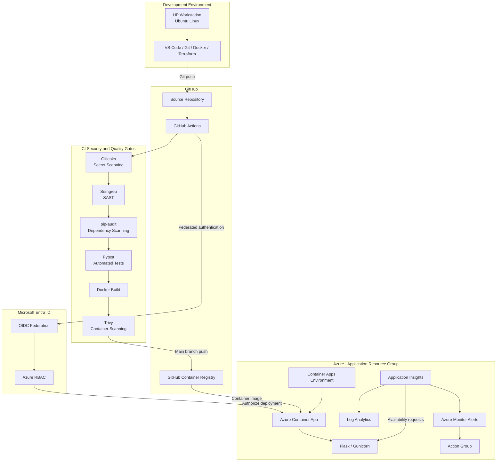
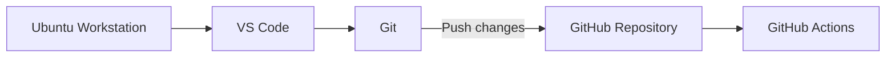
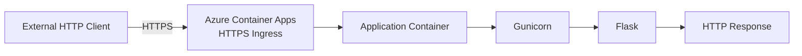
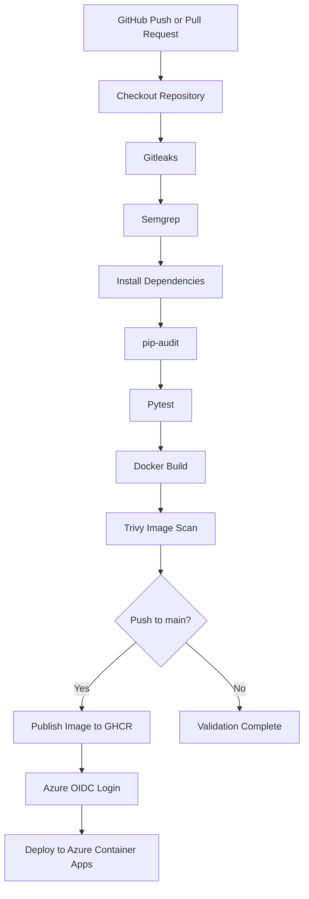
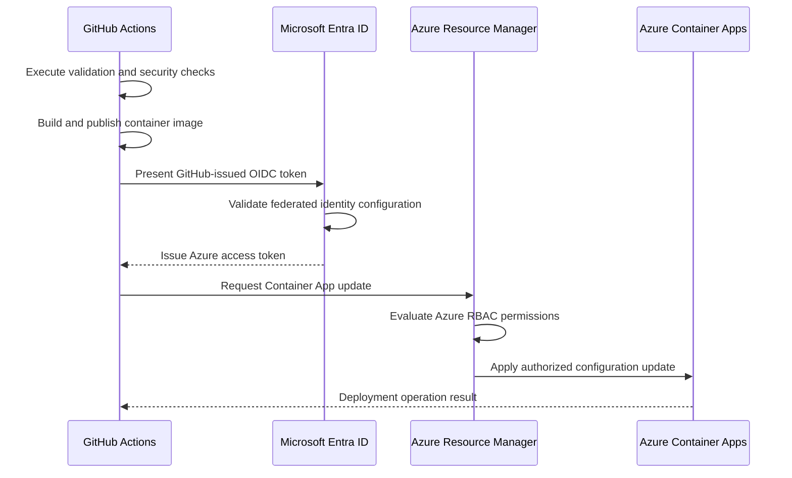
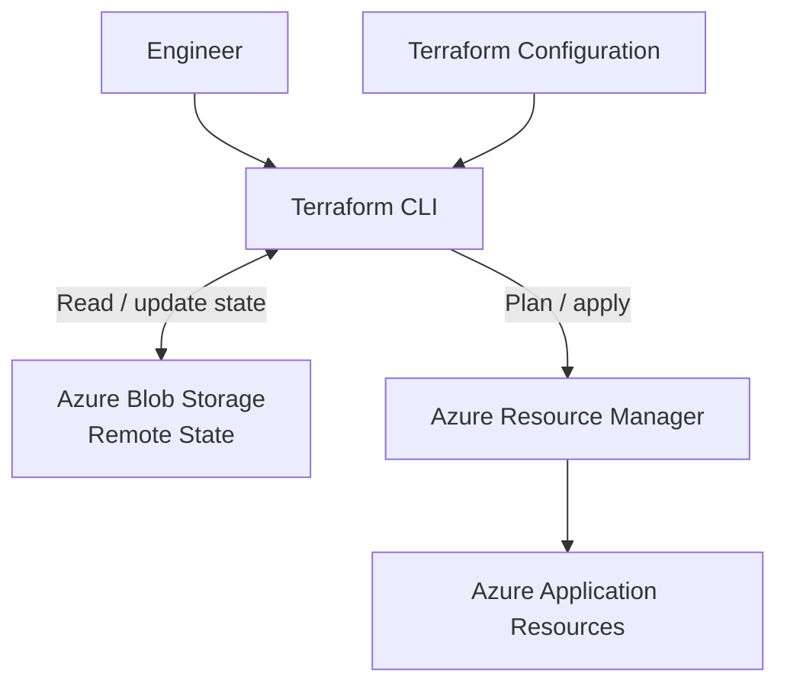
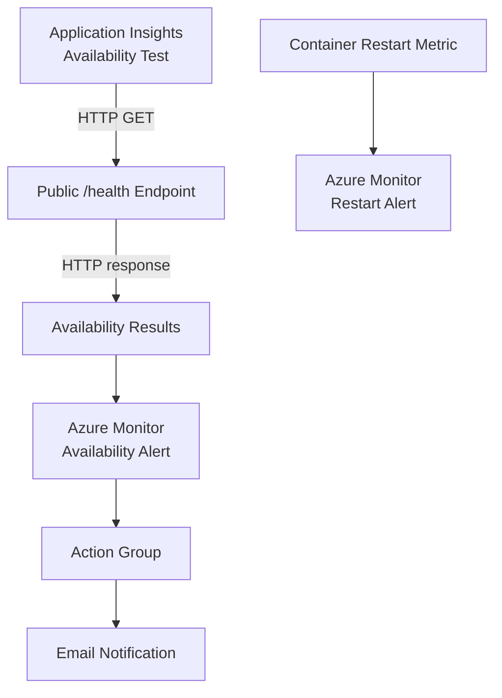

# System Architecture

**Project:** DevSecOps Lab  
**Platform:** Microsoft Azure  
**Infrastructure Management:** Terraform  
**Application Runtime:** Azure Container Apps  
**Delivery Platform:** GitHub Actions  
**Status:** Implemented and deployment validated

---

## 1. Architecture Overview

This project implements a containerized application delivery system using GitHub Actions, Docker, Terraform, and Microsoft Azure.

The architecture demonstrates how application code moves from a developer workstation through automated security and quality checks before deployment to a managed cloud runtime.

The system consists of five primary layers:

1. Development and source control
2. Continuous integration and security validation
3. Container artifact management
4. Cloud infrastructure and application hosting
5. Monitoring and operational visibility

Infrastructure provisioning is managed independently from application delivery.

### Design Objectives

The architecture was designed to:

- Automate application validation and deployment.
- Integrate security checks into the delivery process.
- Avoid storing long-lived Azure deployment credentials in GitHub.
- Maintain infrastructure configuration as version-controlled code.
- Provide application health monitoring and alerting.
- Support reproducible deployments using commit-specific container images.
- Minimize infrastructure management overhead.
- Allow the lab environment to be decommissioned when not needed.

This is a learning environment designed around practical engineering workflows rather than production-scale availability requirements.

---

## 2. High-Level System Architecture

### Diagram Notes

The diagram represents logical relationships, not every Azure API call or network connection.

In the implemented GitHub Actions workflow, validation, image publishing, and deployment currently execute within one job.

The security checks run sequentially. If a required step fails, subsequent steps do not execute.

Azure Container Apps runs the deployed container image. The application is not hosted on the HP workstation.

---

## 3. Development Environment

### Workstation

Development was performed using an HP computer running Ubuntu Linux.

The workstation was configured with a dual-boot operating system setup, allowing Ubuntu to run directly on the hardware.

Ubuntu provides the local environment for:

- Application development
- Git operations
- Docker builds and testing
- Terraform configuration and validation
- Azure CLI administration
- Python development
- VS Code editing

The workstation is used to develop and administer the environment.

It is not a production server or required runtime dependency for the deployed application.

### Development Workflow

### Architectural Significance

Separating the development workstation from the cloud runtime provides several benefits:

- The application can continue running without the workstation being online.
- Deployments are executed through the CI/CD system.
- Source code remains available in GitHub.
- Infrastructure configuration is independent of the local operating system.
- The application can be rebuilt from its source and configuration.

Exact hardware specifications, Ubuntu version, and local installation procedures are documented separately where verified.

See [Workstation Setup](workstation-setup.md).

---

## 4. Application Architecture

### Application Components

| Component | Technology | Responsibility |
|---|---|---|
| Application | Python / Flask | HTTP request handling |
| Application server | Gunicorn | Runs the Python web application |
| Container runtime | Docker-compatible OCI container | Packages application and dependencies |
| Container hosting | Azure Container Apps | Managed application execution |
| Health endpoint | `/health` | Provides HTTP health status |

### Application Request Flow

The application is publicly accessible through the Azure Container Apps HTTPS endpoint.

The container application listens on port `5000`.

Azure Container Apps provides the external ingress layer.

The application exposes two routes:

- `/` — Main application endpoint
- `/health` — Health-check endpoint

### Health Probes

The Container App is configured with:

**Liveness probe**

- Protocol: HTTP
- Port: 5000
- Path: `/health`

**Readiness probe**

- Protocol: HTTP
- Port: 5000
- Path: `/health`

**Startup probe**

- Protocol: TCP
- Port: 5000

These probes support container lifecycle management.

They do not independently verify all application dependencies or business functionality.

---

## 5. CI/CD Architecture

The CI/CD system is implemented using GitHub Actions.

Workflow configuration:

`.github/workflows/ci.yml`

### Pipeline Architecture

### Trigger Conditions

The workflow executes on:

- Pushes to `main`
- Pull requests targeting `main`

Security scanning, testing, and container builds execute for both event types.

Container publishing and Azure deployment execute only for pushes to `main`.

### Security Gates

| Stage | Tool | Purpose |
|---|---|---|
| Secret scanning | Gitleaks | Detect accidentally committed credentials |
| Static analysis | Semgrep | Identify selected insecure code patterns |
| Dependency scanning | pip-audit | Identify known vulnerable Python dependencies |
| Automated testing | Pytest | Validate expected application behavior |
| Image scanning | Trivy | Detect selected OS and library vulnerabilities |

Trivy is configured to fail the workflow for detected high- or critical-severity vulnerabilities within its configured scan scope.

The workflow ignores vulnerabilities without available fixes.

This is a deliberate configuration choice that leaves some residual risk.

### Artifact Versioning

Container images are tagged using the Git commit SHA.

Example:

`ghcr.io/avgdadtech/devsecops-lab:<commit-sha>`

This creates a traceable relationship between a Git commit and its published container image.

The use of commit-specific tags improves traceability but does not, by itself, provide cryptographic artifact provenance or guarantee image immutability.

---

## 6. Identity and Access Architecture

### Authentication Model

GitHub Actions authenticates to Azure using OpenID Connect federation.

The implementation uses:

- GitHub Actions OIDC tokens
- Microsoft Entra ID application identity
- Federated identity credentials
- Azure role-based access control

### Authentication Flow

### Security Benefits

OIDC federation eliminates the need to store a long-lived Azure client secret in the GitHub repository's secrets.

The deployment identity is granted access through Azure RBAC.

For this lab, the deployment service principal has the Contributor role scoped to the application resource group.

This scope is narrower than a subscription-wide Contributor assignment, although the role still grants substantial permissions within that resource group.

### Trust Boundaries

The primary trust boundaries are:

1. Developer workstation to GitHub
2. GitHub source repository to GitHub Actions execution
3. GitHub Actions to GitHub Container Registry
4. GitHub Actions to Microsoft Entra ID
5. Authenticated deployment identity to Azure Resource Manager
6. Public internet to Azure Container Apps ingress

Each boundary has different authentication, authorization, and security requirements.

Detailed security considerations are documented in [Security](security.md).

---

## 7. Azure Infrastructure Architecture

The application infrastructure is deployed in the Azure region:

**Central US**

Primary application resource group:

`rg-devsecops-lab`

### Infrastructure Components

| Resource | Name | Responsibility |
|---|---|---|
| Resource group | `rg-devsecops-lab` | Application resource organization |
| Log Analytics workspace | `workspace-rgdevsecopslabuuWA` | Log and telemetry workspace |
| Container Apps environment | `cae-devsecops-lab` | Managed application environment |
| Container App | `ca-first-app` | Application runtime |
| Application Insights | `ai-devsecops-lab` | Application monitoring resource |
| Availability test | `ca-first-app-health-ai-devsecops-lab` | External endpoint availability checks |
| Action group | `ag-devsecops-lab` | Availability alert notification destination |
| Availability alert | `ca-first-app-health-ai-devsecops-lab` | Availability failure detection |
| Restart alert | `Total Restarts` | Container restart monitoring |

### Runtime Configuration

The Container App is configured with:

- CPU: 0.5 vCPU
- Memory: 1 GiB
- Minimum replicas: 0
- Maximum replicas: 10
- Revision mode: Single
- External HTTPS ingress
- Target port: 5000

### Scaling

The minimum replica count of zero allows the application to scale to zero when idle.

This can reduce compute consumption.

It does not guarantee that the entire Azure environment incurs zero cost.

Other services, including storage, monitoring, and telemetry, may have separate billing behavior.

### Application Availability

The application uses a managed Azure Container Apps environment.

This reduces the need to administer virtual machines or operate a Kubernetes control plane directly.

However, this lab has not established formal production availability objectives, load-test results, or disaster recovery guarantees.

---

## 8. Infrastructure as Code

Terraform is used to define and manage the Azure application infrastructure.

### Terraform Files

| File | Purpose |
|---|---|
| `main.tf` | Azure resource definitions |
| `providers.tf` | Provider and Terraform configuration |
| `backend.tf` | Remote Terraform state configuration |

### Infrastructure Management Flow

### Terraform State

Terraform state is stored in a separate Azure storage account.

State resource group:

`rg-terraform-state`

Storage account:

`sttfstatebb80595d7e`

Blob container:

`tfstate`

State key:

`devsecops-lab.tfstate`

The backend uses Microsoft Entra ID authentication through the Azure CLI.

The storage account has:

- HTTPS-only access
- Minimum TLS version 1.2
- Shared key access disabled
- Public blob access disabled
- Blob versioning enabled
- Blob soft-delete retention
- Container soft-delete retention

Public network access remains enabled for the storage endpoint, subject to Azure authentication and authorization.

### State Separation

The Terraform backend exists outside the application resource group.

This separation is intentional.

It allows Terraform to delete the application infrastructure without deleting the state storage account during the same operation.

The backend requires a separate cleanup procedure when the lab is permanently decommissioned.

### State Validation

The Terraform configuration was reconciled with existing Azure resources.

Nine resources were imported into Terraform state.

After configuration alignment, Terraform reported:

`No changes. Your infrastructure matches the configuration.`

This confirms that Terraform detected no planned changes at the time of validation.

It does not guarantee that no future configuration drift will occur.

### Infrastructure Validation Workflow

The repository also includes:

`.github/workflows/terraform-check.yml`

This workflow performs:

- Terraform initialization without backend access
- Terraform formatting checks
- Terraform configuration validation

It does not currently execute an authenticated Terraform plan in GitHub Actions.

---

## 9. Application Delivery vs. Infrastructure Management

Application deployment and infrastructure provisioning are separate responsibilities.

### Application Delivery

GitHub Actions:

1. Validates application changes.
2. Builds and scans the container.
3. Publishes the approved image.
4. Authenticates to Azure.
5. Updates the Container App image.

### Infrastructure Management

Terraform:

1. Defines Azure resources.
2. Compares desired configuration with deployed infrastructure.
3. Generates an execution plan.
4. Applies approved infrastructure changes.
5. Maintains resource state.

### Avoiding Deployment Conflicts

The Terraform Container App configuration uses a lifecycle rule to ignore changes to the deployed container image.

This allows GitHub Actions to update the application image without Terraform attempting to revert it to an older image reference.

The separation reduces conflicts between the application deployment pipeline and infrastructure management.

It also means Terraform does not enforce the current deployed image version.

---

## 10. Monitoring and Observability

The system uses Azure Application Insights, Log Analytics, and Azure Monitor.

### Monitoring Architecture

### Availability Monitoring

The availability test is configured with:

- Endpoint: `/health`
- HTTP method: GET
- Expected response: HTTP 200
- Test frequency: 5 minutes
- Five geographic test locations
- SSL certificate validation enabled
- Retry enabled

### Availability Alert

The alert evaluates failed availability test locations.

Configured behavior includes:

- Severity: 1
- Evaluation frequency: 1 minute
- Evaluation window: 5 minutes
- Failed location threshold: 2

The availability alert references an action group with an email receiver.

### Restart Alert

A separate Azure Monitor metric alert evaluates container restart activity.

Configured behavior includes:

- Metric: `RestartCount`
- Threshold: Greater than 0
- Severity: 0
- Evaluation frequency: 5 minutes
- Evaluation window: 5 minutes

The restart alert does not currently have an action group configured in Terraform.

Therefore, it should not be represented as having verified email notification delivery.

### Monitoring Limitations

The presence of monitoring resources does not establish comprehensive observability.

This project has not verified:

- End-to-end distributed tracing
- Application performance objectives
- All alert delivery paths
- Incident response automation
- Production monitoring coverage

These are potential future improvements.

---

## 11. Security Architecture

Security controls are distributed across the development, delivery, identity, and infrastructure layers.

### Defense-in-Depth Model

| Layer | Implemented Control |
|---|---|
| Source control | GitHub repository and workflow configuration |
| Secret detection | Gitleaks |
| Application analysis | Semgrep |
| Dependency security | pip-audit |
| Application validation | Pytest |
| Container security | Trivy |
| Deployment restrictions | Main-branch publishing and deployment conditions |
| Cloud authentication | OIDC federation |
| Cloud authorization | Azure RBAC |
| Infrastructure configuration | Terraform |
| State access | Microsoft Entra ID authentication |
| Runtime health | Container health probes |
| External availability | Application Insights availability tests |

These controls address specific risks but do not eliminate all possible attack paths.

### Known Security Gaps

The current architecture includes several areas for improvement:

**GitHub Actions permissions**

The application workflow grants permissions at the job level.

Separating validation and deployment into different jobs would allow more restrictive permissions for untrusted pull-request execution.

**Third-party action pinning**

Some third-party actions use version tags or moving references rather than immutable commit SHAs.

Pinning reviewed actions would reduce dependency and supply-chain risk.

**Terraform drift suppression**

Some monitoring resource properties use Terraform lifecycle ignore rules to accommodate differences in Azure resource identifier formatting and Azure-generated metadata.

These rules also reduce Terraform's ability to detect changes to those ignored properties.

**Deployment recovery**

A live rollback procedure has not been tested.

**Public application endpoint**

The application is publicly accessible and does not implement a comprehensive user authentication system.

These limitations are described in greater detail in [Security](security.md).

---

## 12. Failure Scenarios and Recovery Considerations

The architecture provides mechanisms for detecting and investigating some failures.

| Failure Scenario | Existing Mechanism | Limitation |
|---|---|---|
| Application test failure | Pytest fails CI | Test coverage is limited |
| Detected source secret | Gitleaks fails CI | Detection depends on configured rules |
| Vulnerable dependency | pip-audit fails CI | Depends on vulnerability advisory coverage |
| Vulnerable container image | Trivy fails CI | Unfixed vulnerabilities are ignored |
| Deployment authentication failure | GitHub Actions reports failure | Requires investigation and correction |
| Application health failure | Health probes and availability monitoring | Does not identify every root cause |
| Container restart | Azure Monitor metric alert | Notification action is not configured |
| Infrastructure drift | Terraform plan | Ignored properties are not fully evaluated |
| Bad application deployment | Previous image may be redeployed | Rollback has not been exercised |

Operational procedures will be maintained in [Operations](operations.md).

---

## 13. Engineering Trade-Offs

### Azure Container Apps Instead of AKS

Azure Container Apps was selected to provide managed container hosting without the operational complexity of managing a Kubernetes cluster.

This was appropriate for a small application with limited orchestration requirements.

### Terraform Instead of Manual-Only Provisioning

Terraform provides a version-controlled representation of the infrastructure and supports repeatable planning and lifecycle management.

Some resources were initially created outside Terraform and subsequently imported.

### GitHub Actions Instead of a Separate CI/CD Platform

GitHub Actions integrates directly with the source repository and supports the required build, scanning, authentication, and deployment operations.

### OIDC Instead of Long-Lived Credentials

Federated authentication reduces the need to manage persistent Azure client secrets within GitHub.

### Git-SHA Image Tags

Commit-specific tags improve traceability and make it easier to identify which source revision produced a deployed image.

### Managed Monitoring Services

Azure Monitor and Application Insights provide monitoring capabilities without operating a separate monitoring platform.

These choices prioritize learning, maintainability, and reduced infrastructure overhead over advanced orchestration or large-scale production requirements.

See [Architecture Decisions](decisions.md).

---

## 14. Cost and Environment Lifecycle

The application environment is intended to be temporary.

When active development is complete, the Azure resources can be removed to minimize ongoing costs.

### Decommissioning Order

1. Verify source code and documentation are committed to GitHub.
2. Capture final deployment and monitoring evidence.
3. Review the Terraform destroy plan.
4. Confirm that only intended lab resources are included.
5. Destroy the Terraform-managed application infrastructure.
6. Verify that the application resources have been removed.
7. Identify and clean up remaining unmanaged lab resources.
8. Remove the separate Terraform state backend only after confirming it is no longer needed.
9. Review Azure billing and remaining subscription resources.

Stopping the Container App alone is not equivalent to deleting all billable Azure resources.

The source repository and Terraform configuration can be retained after infrastructure teardown.

---

## 15. Validation Summary

The following implementation outcomes were verified during the project:

| Capability | Status |
|---|---|
| Flask application containerization | Verified |
| Automated application testing | Verified |
| Secret scanning | Verified through successful pipeline execution |
| Static code scanning | Verified through successful pipeline execution |
| Dependency scanning | Verified through successful pipeline execution |
| Container vulnerability scanning | Verified through successful pipeline execution |
| GitHub Container Registry publishing | Verified |
| Azure OIDC authentication | Verified |
| Automated Azure Container Apps deployment | Verified |
| Public health endpoint returning HTTP 200 | Verified |
| Terraform remote state migration | Verified |
| Terraform state containing nine resources | Verified |
| Terraform no-change plan | Verified |
| Monitoring resource configuration | Verified |
| Live alert notification delivery | Not comprehensively tested |
| Application rollback | Not tested |
| Disaster recovery | Not tested |
| Production load and performance | Not tested |

A successful security scan means the configured checks completed successfully. It does not establish that the application is free of vulnerabilities.

---

## 16. Future Engineering Improvements

Potential improvements include:

1. Separate CI validation and deployment into least-privilege jobs.
2. Pin third-party GitHub Actions to immutable commit SHAs.
3. Implement stronger deployment verification after Azure updates.
4. Test deployment rollback using a known-good container image.
5. Improve Terraform handling of monitoring resource drift.
6. Configure and test restart alert notifications.
7. Add structured application logging and correlation identifiers.
8. Expand automated test coverage.
9. Establish recovery objectives and test infrastructure reconstruction.
10. Introduce additional runtime security controls as application requirements grow.

These improvements are not represented as completed functionality.

---

## 17. Related Documentation

- [Project Overview](../README.md)
- [Architecture Decisions](decisions.md)
- [Security Architecture and Threat Model](security.md)
- [Operational Runbook](operations.md)
- [Development Workstation](workstation-setup.md)

---

## Conclusion

This architecture demonstrates a working application delivery system integrating development, automated validation, container security, cloud authentication, infrastructure as code, and operational monitoring.

The primary engineering outcome is an implemented and validated delivery workflow, supported by version-controlled infrastructure definitions and explicit documentation of architectural limitations.

The system is intentionally scoped as a learning environment and is not presented as a fully hardened production platform.
