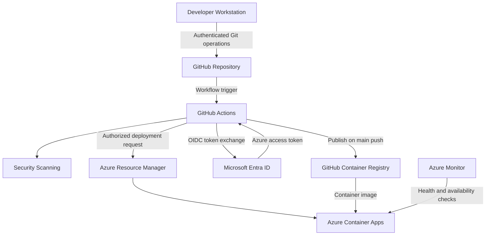

# Security Architecture & Threat Model

**Project:** DevSecOps Lab  
**Document Type:** Security Architecture and Threat Assessment  
**Environment:** Microsoft Azure  
**Assessment Scope:** Application, CI/CD, identity, infrastructure, and monitoring  
**Assessment Date:** October 2026  
**Classification:** Public portfolio documentation

---

## 1. Executive Summary

This document evaluates the security architecture of the DevSecOps Lab.

The project implements a Python Flask application deployed to Azure Container Apps through an automated GitHub Actions pipeline.

Security controls are integrated across the development, build, deployment, and infrastructure management lifecycle.

Implemented controls include:

- Secret scanning with Gitleaks
- Static application security testing with Semgrep
- Python dependency vulnerability scanning with pip-audit
- Container image vulnerability scanning with Trivy
- Automated application testing with Pytest
- GitHub Actions deployment restrictions
- Microsoft Entra ID workload identity federation
- Azure role-based access control
- Terraform infrastructure management
- Azure Blob Storage remote state with identity-based authentication
- Application health monitoring and availability alerting

These controls provide meaningful security coverage for the project's scope.

However, successful pipeline execution does not establish that the application is free of vulnerabilities.

The environment has not undergone a comprehensive penetration test, production security assessment, or formal compliance audit.

### Security Objectives

The primary objectives are to:

1. Reduce the likelihood of committing credentials to source control.
2. Identify selected application and dependency vulnerabilities before deployment.
3. Detect known vulnerabilities in container images.
4. Avoid long-lived Azure deployment credentials.
5. Restrict application deployment to the intended Git branch.
6. Control access to cloud infrastructure and Terraform state.
7. Maintain traceability between source code and deployed artifacts.
8. Detect selected application availability and runtime failures.
9. Document residual risks and required improvements.

---

## 2. Scope and Assumptions

### In Scope

This assessment covers:

- GitHub repository
- GitHub Actions workflows
- Python Flask application
- Python dependencies
- Docker container image
- GitHub Container Registry
- Microsoft Entra ID deployment identity
- Azure Container Apps
- Terraform configuration
- Terraform remote state
- Azure monitoring and alerting

### Out of Scope

The following areas were not comprehensively assessed:

- Physical security of the development workstation
- Home network security
- GitHub account security settings
- Microsoft Entra tenant-wide security posture
- Azure subscription-wide security posture
- Third-party service infrastructure
- Advanced application penetration testing
- Formal regulatory compliance
- Production disaster recovery

### Assumptions

The assessment assumes that GitHub, Microsoft Azure, and the associated identity services operate according to their documented security models.

It does not assume that these services eliminate application-level security responsibilities.

---

## 3. Assets Requiring Protection

| Asset | Security Concern | Potential Impact |
|---|---|---|
| Application source code | Unauthorized modification | Malicious or unintended application behavior |
| GitHub repository | Unauthorized commits or workflow changes | Compromised delivery pipeline |
| GitHub Actions workflows | Malicious execution or privilege misuse | Unauthorized artifact publishing or deployment |
| Container images | Artifact tampering or vulnerable dependencies | Deployment of compromised software |
| Azure deployment identity | Unauthorized token use | Unauthorized infrastructure changes |
| Azure Container App | Exploitation or misconfiguration | Service disruption or application compromise |
| Terraform configuration | Unauthorized infrastructure changes | Insecure cloud configuration |
| Terraform state | Disclosure or tampering | Exposure of infrastructure information or loss of state integrity |
| Monitoring configuration | Unauthorized modification | Reduced incident visibility |
| Developer workstation | Credential theft or malicious code execution | Compromise of development and administrative access |

### Asset Criticality

The most security-sensitive components in this architecture are:

1. GitHub repository and workflow configuration
2. Azure deployment identity
3. Terraform state
4. Container artifacts
5. Cloud administration credentials

Compromise of these components could affect the integrity of the deployed application or infrastructure.

---

## 4. Threat Model

The threat model identifies plausible attack scenarios and the controls available to address them.

It is not a claim that every scenario has been simulated or tested.

### Threat Actors

Potential threat actors include:

- External attackers targeting the public application endpoint
- Attackers attempting to compromise source code or dependencies
- Malicious contributors or compromised GitHub accounts
- Attackers targeting CI/CD workflows
- Attackers attempting to obtain cloud credentials
- Individuals with excessive cloud permissions

Accidental errors and misconfigurations are also considered security risks.

### Threat Categories

The assessment considers:

- Spoofing
- Tampering
- Repudiation
- Information disclosure
- Denial of service
- Elevation of privilege

These categories are based on the STRIDE threat-modeling framework.

---

## 5. Security Architecture Diagram



### Trust Boundaries

The architecture contains several important trust boundaries.

**Boundary 1: Developer workstation to GitHub**

Source code moves from a locally administered workstation to a hosted repository.

Risks include compromised credentials, malicious commits, and accidental disclosure of sensitive information.

**Boundary 2: GitHub repository to CI execution**

Repository content and workflow definitions influence the commands executed by GitHub Actions.

Risks include malicious workflow changes, dependency compromise, and unsafe execution of untrusted contributions.

**Boundary 3: CI execution to artifact registry**

GitHub Actions publishes container images to GHCR.

Risks include artifact tampering, compromised build dependencies, and unauthorized publishing.

**Boundary 4: GitHub Actions to Microsoft Entra ID**

The workflow exchanges a GitHub-issued OIDC token for Azure authentication.

Risks include incorrect federation conditions and excessive authorization.

**Boundary 5: Deployment identity to Azure resources**

The authenticated deployment identity can modify authorized Azure resources.

Risks include privilege misuse and unauthorized infrastructure changes.

**Boundary 6: Public internet to application runtime**

External clients can access the application's public HTTPS endpoint.

Risks include application exploitation, abusive traffic, and denial of service.

---

## 6. CI/CD Security Controls

### 6.1 Secret Scanning — Gitleaks

**Implemented:** Yes

Gitleaks scans repository content for patterns associated with exposed credentials and secrets.

The scan executes during GitHub Actions CI.

#### Security Objective

Reduce the risk of accidentally introducing sensitive credentials into source control.

#### Limitations

- Detection depends on configured rules.
- Not every credential format can be identified.
- Previously exposed credentials require revocation or rotation.
- Secret scanning does not replace secure credential storage.

A successful Gitleaks scan means no findings blocked the configured scan. It does not prove that the repository contains no sensitive information.

---

### 6.2 Static Application Security Testing — Semgrep

**Implemented:** Yes

Semgrep analyzes application source code using configured Python security rules.

The workflow uses:

`semgrep scan --config p/python --error .`

#### Security Objective

Identify selected insecure code patterns before deployment.

#### Limitations

- Rule coverage is limited to the configured ruleset.
- Static analysis may produce false positives or false negatives.
- Runtime behavior is not comprehensively evaluated.
- Business logic vulnerabilities may not be detected.

The current configuration does not represent a comprehensive application security assessment.

---

### 6.3 Dependency Vulnerability Scanning — pip-audit

**Implemented:** Yes

The workflow audits dependencies listed in the Python requirements file.

Command:

`pip-audit -r requirements.txt`

#### Security Objective

Identify dependencies associated with known vulnerability advisories.

#### Limitations

- Advisory coverage varies.
- Newly discovered vulnerabilities may not yet be reported.
- Dependency scanning does not identify every application vulnerability.
- Vulnerability severity and exploitability require contextual evaluation.

---

### 6.4 Automated Testing — Pytest

**Implemented:** Yes

Pytest executes application tests before image publishing and deployment.

#### Security Relevance

Automated tests help detect regressions and unexpected application behavior.

However, the existing tests are not represented as a comprehensive security test suite.

Additional authentication, authorization, input validation, and negative testing would be required for a more complex application.

---

### 6.5 Container Vulnerability Scanning — Trivy

**Implemented:** Yes

The workflow scans the built Docker image.

Configured scan scope:

- Operating system packages
- Application libraries
- High-severity vulnerabilities
- Critical-severity vulnerabilities

The scan is configured to fail on qualifying findings.

#### Important Configuration Detail

The workflow uses:

`ignore-unfixed: true`

This means vulnerabilities without available fixes are excluded from the blocking criteria.

#### Security Consequence

The pipeline can succeed even when some known vulnerabilities remain in the image.

This is a documented residual risk.

#### Future Improvement

Introduce a documented vulnerability management process that considers:

- Severity
- Exploitability
- Exposure
- Available remediation
- Compensating controls
- Exception expiration dates

---

## 7. GitHub Actions Security

### Current Workflow Design

The application workflow runs on:

- Pushes to `main`
- Pull requests targeting `main`

Security checks, automated tests, and container builds execute for both event types.

Publishing and deployment steps are restricted using:

```yaml
if: github.event_name == 'push' && github.ref == 'refs/heads/main'
```

This condition is applied to:

1. GHCR authentication
2. Container image tagging
3. Container image publishing
4. Azure OIDC authentication
5. Azure Container Apps deployment

### Security Benefit

Pull-request workflow runs do not execute these publishing or deployment steps.

### Remaining Risk: Job Permissions

The current workflow grants the following permissions at the job level:

```yaml
permissions:
  contents: read
  packages: write
  id-token: write
```

The permissions apply to the entire job rather than only the deployment steps.

GitHub's event-specific token restrictions may further limit effective permissions, but the workflow does not currently enforce separate least-privilege jobs.

### Recommended Improvement

Separate the workflow into:

**Validation job**

- Read-only repository permissions
- Secret scanning
- Static analysis
- Dependency scanning
- Automated tests
- Container build and scanning

**Deployment job**

- Runs only after successful validation
- Executes only for authorized pushes to `main`
- Receives package publishing permissions
- Receives OIDC token permissions
- Publishes and deploys the approved image

This would establish a stronger permission boundary.

### Third-Party Action Security

The workflow uses external GitHub Actions.

Some actions are referenced using tags or moving branches rather than immutable commit SHAs.

A moving reference can change without a corresponding workflow modification.

#### Recommended Improvement

Pin third-party actions to reviewed commit SHAs.

Review dependency updates before adoption.

### Branch Protection

Branch protection and repository rulesets have not been verified as part of this assessment.

The workflow's branch condition should not be confused with branch protection.

For stronger controls, consider:

- Required pull-request reviews
- Required status checks
- Restricted direct pushes
- Protection against unauthorized workflow modification

---

## 8. Identity and Access Management

### Authentication Architecture

GitHub Actions authenticates to Azure through Microsoft Entra ID workload identity federation.

The workflow uses GitHub-issued OIDC tokens.

Azure validates the configured federated identity relationship before issuing an access token.

### Implemented Benefits

- No long-lived Azure client secret is required for deployment.
- Authentication is based on federated identity.
- Azure RBAC controls authorized resource access.
- The deployment identity is scoped to the application resource group.

### Authorization Configuration

The deployment service principal has:

**Role:** Contributor  
**Scope:** `rg-devsecops-lab`

### Risk Assessment

Resource-group-scoped Contributor access is narrower than subscription-wide Contributor access.

However, Contributor remains a broad role.

A compromised authorized deployment workflow could potentially modify multiple resources within the application resource group.

### Recommended Improvement

Evaluate a custom Azure role containing only the permissions required to deploy the application.

This would reduce the potential impact of deployment identity compromise.

### Federation Configuration

The implemented federation is associated with the GitHub repository and its main branch.

Federation conditions should be reviewed when repository ownership, branch structure, or deployment architecture changes.

---

## 9. Container and Runtime Security

### Runtime Architecture

The application runs in Azure Container Apps.

Configured characteristics include:

- Managed container hosting
- External HTTPS ingress
- Application target port 5000
- Liveness probe
- Readiness probe
- Startup probe
- Minimum replicas: 0
- Maximum replicas: 10

### Security Benefits

Managed hosting reduces the need to administer the underlying operating system and orchestration infrastructure directly.

Health probes support application lifecycle management.

### Security Limitations

Managed hosting does not eliminate responsibility for:

- Application vulnerabilities
- Container dependencies
- Runtime configuration
- Secrets management
- Access control
- Network exposure
- Monitoring and incident response

### Public Endpoint

The application is accessible through a public HTTPS endpoint.

The current application is a small demonstration service and does not implement a comprehensive authentication system.

It should not be treated as a secure platform for storing customer information or sensitive business data.

### Runtime Hardening

The following controls have not been comprehensively verified:

- Non-root container execution
- Read-only root filesystem
- Runtime privilege restrictions
- Application-layer rate limiting
- Web application firewall protections
- Private network ingress
- Comprehensive application access controls

These controls should be evaluated against future application requirements.

---

## 10. Infrastructure as Code Security

### Terraform

Terraform manages the Azure application infrastructure.

The project uses version-controlled configuration and a remote state backend.

### Security Benefits

- Infrastructure configuration is reviewable.
- Changes can be inspected through Terraform plans.
- Configuration is retained in source control.
- Infrastructure can be reconstructed from configuration when dependencies and access are available.

### Important Limitation

Terraform plans identify differences between configuration and managed resources.

They are not security assessments.

A no-change Terraform plan does not establish that the infrastructure is securely configured.

### Drift Detection

The Container App image property is intentionally excluded from Terraform change management because GitHub Actions owns application image deployment.

Some monitoring properties are also excluded through Terraform lifecycle ignore rules.

These exclusions reduce the scope of drift detection.

### Recommended Improvement

Review lifecycle ignore rules and eliminate unnecessary exclusions.

Document which system is authoritative for each managed property.

---

## 11. Terraform State Security

### Backend Architecture

Terraform state is stored in Azure Blob Storage.

The backend resides outside the application resource group.

### Implemented Controls

| Control | Status |
|---|---|
| Azure Blob remote state | Implemented |
| Microsoft Entra ID authentication | Implemented |
| Azure RBAC access | Implemented |
| HTTPS-only access | Implemented |
| Minimum TLS 1.2 | Implemented |
| Shared key access disabled | Implemented |
| Public blob access disabled | Implemented |
| Blob versioning | Implemented |
| Blob soft delete | Implemented |
| Container soft delete | Implemented |

### Network Exposure

The storage account allows public network connectivity.

This does not mean anonymous blob access is enabled.

Authentication and authorization are still required.

However, public network accessibility increases the importance of identity security and access control.

### Sensitive State Data

Terraform state can contain:

- Resource identifiers
- Infrastructure configuration
- Provider-managed attributes
- Potentially sensitive values

State files must not be committed to a public repository.

### Recommended Controls

- Restrict access to authorized identities.
- Review Azure RBAC assignments.
- Protect state backups.
- Avoid storing unnecessary secrets in Terraform-managed values.
- Retain state until infrastructure teardown is complete.
- Delete obsolete state copies according to a documented retention process.

---

## 12. Monitoring Security

### Implemented Monitoring

The project includes:

- Azure Application Insights
- Log Analytics
- Availability testing
- Availability alert
- Container restart alert
- Monitoring action group

### Availability Monitoring

The availability test sends recurring requests to the public `/health` endpoint.

The configured alert evaluates failed test locations.

An email receiver is associated with the availability action group.

### Restart Monitoring

A separate alert evaluates container restart activity.

The restart alert does not currently have an action group configured in Terraform.

Therefore, email notification delivery should not be assumed for this alert.

### Security Relevance

Availability monitoring can help detect service disruptions.

However, availability monitoring is not equivalent to security event detection.

The project does not implement a comprehensive security information and event management system.

### Limitations

The following capabilities have not been comprehensively validated:

- Security event correlation
- Intrusion detection
- Automated incident containment
- Alert escalation
- End-to-end incident response
- Security-specific detection rules

---

## 13. Threat Scenarios

The following scenarios illustrate how the architecture could be attacked or misused.

### T-01: Accidental Credential Exposure

**Scenario:** A developer commits an API key to the repository.

**Potential impact:** Unauthorized access to the associated service.

**Existing control:** Gitleaks secret scanning.

**Residual risk:** Credentials may not match detection rules, or may already have been exposed.

**Recommended response:** Revoke exposed credentials, investigate usage, remove sensitive material from accessible history where appropriate, and improve prevention.

---

### T-02: Compromised Python Dependency

**Scenario:** A dependency contains a known vulnerability or malicious code.

**Potential impact:** Application compromise or unintended execution.

**Existing control:** pip-audit checks known dependency vulnerabilities.

**Residual risk:** Unknown vulnerabilities and malicious packages may not be detected.

**Recommended improvement:** Dependency pinning, provenance review, controlled updates, and additional supply-chain checks.

---

### T-03: Vulnerable Container Image

**Scenario:** The deployed image contains exploitable operating system or library vulnerabilities.

**Potential impact:** Runtime compromise.

**Existing control:** Trivy image scanning.

**Residual risk:** Unfixed vulnerabilities are excluded from blocking criteria.

**Recommended improvement:** Establish vulnerability exception and remediation procedures.

---

### T-04: Unauthorized Workflow Modification

**Scenario:** An attacker gains permission to modify GitHub Actions configuration.

**Potential impact:** Unauthorized publishing, credential access, or deployment.

**Existing controls:** GitHub authentication and main-branch deployment conditions.

**Residual risk:** Repository protection settings and workflow change approvals have not been verified.

**Recommended improvement:** Require reviews and status checks for protected branches.

---

### T-05: Excessive Deployment Permissions

**Scenario:** An attacker compromises an authorized deployment workflow.

**Potential impact:** Unauthorized modification of resources within the application resource group.

**Existing control:** Azure RBAC scoped to the resource group.

**Residual risk:** Contributor grants broader permissions than a narrowly scoped deployment role.

**Recommended improvement:** Introduce least-privilege deployment permissions.

---

### T-06: Terraform State Disclosure

**Scenario:** An unauthorized identity gains access to Terraform state.

**Potential impact:** Disclosure of infrastructure configuration and potentially sensitive attributes.

**Existing controls:** Microsoft Entra ID authentication and Azure RBAC.

**Residual risk:** Misconfigured identity permissions or compromised authorized credentials.

**Recommended improvement:** Periodic access reviews and secure state backup handling.

---

### T-07: Public Application Exploitation

**Scenario:** An external attacker targets the public application endpoint.

**Potential impact:** Service disruption or application compromise.

**Existing controls:** Managed HTTPS ingress, application testing, and security scanning.

**Residual risk:** No comprehensive application security assessment or advanced runtime protections.

**Recommended improvement:** Add application-specific security testing and runtime controls as requirements increase.

---

### T-08: Monitoring Misconfiguration

**Scenario:** An application failure occurs without effective notification.

**Potential impact:** Delayed detection and response.

**Existing controls:** Availability testing and configured monitoring alerts.

**Residual risk:** Alert delivery has not been comprehensively tested; restart notifications are not configured.

**Recommended improvement:** Test alert delivery and establish an incident response procedure.

---

## 14. Risk Register

Risk ratings below are qualitative engineering estimates for this learning environment.

They are not derived from a formal quantitative risk assessment.

| ID | Risk | Estimated Priority | Current Status |
|---|---|---|---|
| R-01 | Broad CI/CD job permissions | High | Open |
| R-02 | Third-party actions using mutable references | High | Open |
| R-03 | Broad deployment Contributor role | Medium | Open |
| R-04 | Incomplete runtime security validation | Medium | Open |
| R-05 | Unfixed vulnerabilities excluded from blocking | Medium | Accepted for lab; requires review for production |
| R-06 | Terraform monitoring drift exclusions | Medium | Open |
| R-07 | Untested rollback procedure | Medium | Open |
| R-08 | Incomplete alert delivery testing | Medium | Open |
| R-09 | Publicly accessible application endpoint | Context-dependent | Accepted for demonstration application |
| R-10 | Incomplete disaster recovery validation | Medium | Open |

### Risk Interpretation

These priorities reflect potential engineering significance, not confirmed exploitation.

Risk acceptance for this learning environment should not automatically carry over to customer-facing systems.

---

## 15. Recommended Remediation Roadmap

### Priority 1 — CI/CD Security

**Separate validation and deployment jobs.**

Target outcome:

- Read-only permissions for validation
- Publishing permissions only for deployment
- OIDC permissions only for deployment
- Explicit deployment dependencies
- Main-branch deployment restrictions

**Pin third-party GitHub Actions to immutable commit SHAs.**

Target outcome:

- Reduced exposure to unexpected changes in action dependencies

### Priority 2 — Deployment Identity

Review the permissions required to update Azure Container Apps.

Evaluate whether a narrower custom role can replace Contributor.

### Priority 3 — Deployment Integrity

Evaluate:

- Container image digest deployment
- Artifact signing
- Provenance verification
- Deployment verification after rollout

### Priority 4 — Infrastructure Configuration

Reduce unnecessary Terraform lifecycle exclusions.

Improve drift detection for monitoring resources.

### Priority 5 — Operational Security

- Test alert notification delivery
- Configure restart alert notifications
- Test rollback procedures
- Document incident response
- Validate infrastructure reconstruction

---

## 16. Security Validation Status

| Security Capability | Implementation | Validation |
|---|---|---|
| Secret scanning | Gitleaks | Successful CI execution |
| Static analysis | Semgrep | Successful CI execution |
| Dependency scanning | pip-audit | Successful CI execution |
| Container scanning | Trivy | Successful CI execution |
| Automated testing | Pytest | Successful CI execution |
| Main-branch deployment restrictions | GitHub Actions conditions | Successful main-branch pipeline |
| Azure OIDC authentication | Microsoft Entra federation | Successful deployment |
| Azure RBAC authorization | Resource-group-scoped Contributor | Successful authorized deployment |
| Terraform remote state | Azure Blob Storage | Successful migration and access |
| Infrastructure reconciliation | Terraform | No-change plan |
| Application health monitoring | Health probes and availability test | Health endpoint verified |
| Availability alert delivery | Action group configured | Not comprehensively tested |
| Container restart notifications | Restart alert configured | Notification destination not configured |
| Application rollback | Procedure can be documented | Not tested |
| Penetration testing | Not implemented | Not tested |
| Disaster recovery | Not fully implemented | Not tested |

### Interpretation

A successful CI pipeline demonstrates that the configured checks executed successfully.

It does not establish that the application is free from vulnerabilities or that every security control has been independently validated.

---

## 17. Security Engineering Conclusions

The DevSecOps Lab implements a practical set of security controls across source code, dependencies, container artifacts, deployment identity, and infrastructure management.

The most significant implemented security decision is the use of OIDC federation for Azure deployment authentication rather than a persistent Azure client secret.

The CI/CD pipeline also integrates automated security checks before application publishing and deployment.

However, the architecture retains important limitations:

- CI/CD permissions are not fully separated.
- Third-party action dependencies require additional hardening.
- Deployment identity permissions could be narrower.
- Runtime security controls are limited.
- Some infrastructure properties are excluded from drift detection.
- Alert delivery and rollback have not been comprehensively tested.

The project demonstrates applied DevSecOps practices but is not represented as a fully hardened production environment.

The appropriate next step is to apply these practices to applications with real operational requirements while strengthening the controls identified in this assessment.

---

## Related Documentation

- [Project Overview](../README.md)
- [System Architecture](architecture.md)
- [Architecture Decisions](decisions.md)
- [Operational Runbook](operations.md)
- [Development Workstation](workstation-setup.md)
