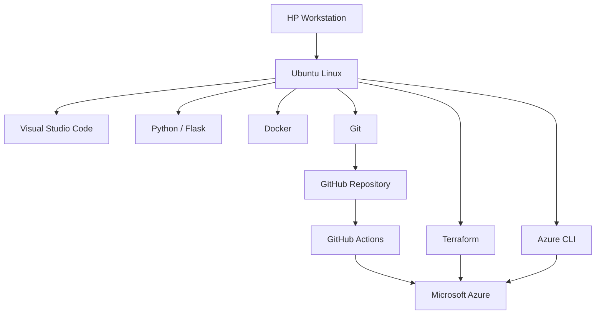
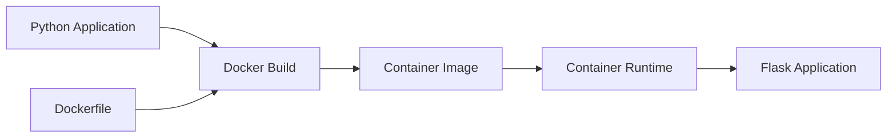

# Development Workstation & Linux Environment

**Project:** DevSecOps Lab  
**Platform:** HP Workstation / Ubuntu Linux  
**Environment Type:** Local development and cloud administration  
**Status:** Implemented; exact system specifications pending verification

---

## 1. Purpose

This document describes the local development environment used to build and administer the DevSecOps Lab.

The environment supports:

- Linux administration
- Python application development
- Container development
- Git-based source control
- Infrastructure as Code
- Azure cloud administration
- CI/CD development and troubleshooting

The workstation is a development and administration system.

It is not the production runtime for the application.

The deployed application runs independently in Microsoft Azure Container Apps.

---

## 2. Workstation Architecture

### Hardware

The project was developed using an HP computer configured to run Ubuntu Linux directly on the hardware.

The workstation uses a dual-boot operating system configuration.

Exact hardware specifications have not yet been recorded.

### Operating System

**Distribution:** Ubuntu Linux  
**Installation:** Native installation  
**Configuration:** Dual boot  
**Ubuntu release:** Pending verification  
**Linux kernel:** Pending verification  
**Storage partition layout:** Pending verification

### Architectural Rationale

Ubuntu provides a Linux environment suitable for software development, container operations, infrastructure automation, and cloud administration.

Running Linux directly on the workstation provides practical experience with:

- Shell commands
- Filesystem navigation
- File permissions
- Package management
- Process management
- Networking
- Development tooling
- Cloud administration utilities

The dual-boot configuration allows multiple operating systems to be maintained on the same physical computer.

The project does not require dual boot to function. It was a workstation configuration choice rather than an application architecture requirement.

---

## 3. Development Environment Architecture



The workstation provides the tools required to develop, test, and administer the system.

GitHub Actions executes the automated CI/CD pipeline on GitHub-hosted runners.

Azure Container Apps hosts the deployed application.

The workstation does not need to remain powered on for the deployed application to operate.

---

## 4. Development Toolchain

The following tools were used during the project.

| Tool | Responsibility |
|---|---|
| Ubuntu Linux | Development operating system |
| Terminal / Bash | Command execution and administration |
| Visual Studio Code | Source code and configuration editing |
| Git | Version control |
| GitHub | Source repository |
| Python | Application development |
| Flask | HTTP application framework |
| Gunicorn | Python application server |
| Pytest | Automated application testing |
| Docker | Container image development |
| Terraform | Infrastructure as Code |
| Azure CLI | Azure administration |
| GitHub Actions | CI/CD automation |

Security scanning tools are primarily executed through the GitHub Actions workflow.

They do not all need to be installed locally to reproduce the automated pipeline.

---

## 5. Project Directory Structure

The project was developed in the following local directory:

```text
~/projects/devsecops-lab/
```

The repository contains:

```text
devsecops-lab/
|
|-- README.md
|
|-- docs/
|   |-- architecture.md
|   |-- decisions.md
|   |-- security.md
|   |-- operations.md
|   |-- workstation-setup.md
|
|-- 01-first-container/
|   |-- app.py
|   |-- test_app.py
|   |-- requirements.txt
|   |-- Dockerfile
|
|-- terraform/
|   |-- main.tf
|   |-- providers.tf
|   |-- backend.tf
|
|-- .github/
|   |-- workflows/
|       |-- ci.yml
|       |-- terraform-check.yml
|
|-- .gitignore
```

The repository is hosted at:

https://github.com/AvgDadTech/devsecops-lab

---

## 6. Git and GitHub Configuration

Git provides version control for application code, infrastructure configuration, and automation workflows.

The local repository is connected to GitHub.

### Standard Development Workflow

```bash
cd ~/projects/devsecops-lab
```

Review changes:

```bash
git status
```

Stage changes:

```bash
git add .
```

Commit changes:

```bash
git commit -m "Describe the change"
```

Push changes:

```bash
git push origin main
```

### Engineering Considerations

Direct pushes to `main` were used during development.

For collaborative or production environments, pull requests and branch protection are generally preferable.

Repository authentication should use supported secure authentication mechanisms.

Credentials and private keys must not be committed to the repository.

---

## 7. Python Development Environment

The application is implemented using Python and Flask.

Application source code is located in:

```text
01-first-container/
```

### Application Files

| File | Purpose |
|---|---|
| `app.py` | Flask application |
| `test_app.py` | Automated application tests |
| `requirements.txt` | Python dependencies |
| `Dockerfile` | Container build definition |

### Example Local Setup

The following commands illustrate a standard Python virtual environment workflow.

They are provided as reproducibility guidance, not as a verified transcript of the original installation.

```bash
cd ~/projects/devsecops-lab/01-first-container
```

Create a virtual environment:

```bash
python3 -m venv .venv
```

Activate it:

```bash
source .venv/bin/activate
```

Install dependencies:

```bash
python -m pip install -r requirements.txt
```

Run tests:

```bash
python -m pytest
```

### Why Use a Virtual Environment?

A Python virtual environment isolates project dependencies from the system Python installation.

This reduces conflicts between projects and helps maintain a consistent development environment.

---

## 8. Docker Development

Docker packages the application and its dependencies into a container image.

### Build the Application Image

From the application directory:

```bash
docker build -t devsecops-lab:local .
```

### Run the Container Locally

```bash
docker run --rm -p 5000:5000 devsecops-lab:local
```

The application should be accessible through the local workstation.

### Verify the Health Endpoint

From another terminal:

```bash
curl -i http://localhost:5000/health
```

Expected successful response:

```text
HTTP 200
```

The exact response formatting depends on the application server.

### Stop the Container

When running interactively, use:

```text
Ctrl+C
```

### Container Architecture



### Engineering Considerations

Containerization provides a repeatable application package.

It does not eliminate the need to:

- Maintain dependencies
- Patch vulnerable images
- Manage secrets
- Validate runtime permissions
- Test application behavior

---

## 9. Terraform Development

Terraform manages the Azure infrastructure.

Configuration files are located in:

```text
terraform/
```

### Initialize Terraform

```bash
cd ~/projects/devsecops-lab/terraform
```

```bash
terraform init
```

### Check Formatting

```bash
terraform fmt -check
```

### Validate Configuration

```bash
terraform validate
```

### Review Infrastructure

```bash
terraform plan
```

### Review Managed Resources

```bash
terraform state list
```

### Terraform State

The project uses an Azure Blob Storage remote backend.

Backend configuration is defined in:

```text
terraform/backend.tf
```

The backend uses Microsoft Entra ID authentication through Azure CLI credentials.

### Important Security Considerations

Terraform state may contain sensitive infrastructure information.

Do not commit state files, local state backups, or credentials to GitHub.

Infrastructure changes should be reviewed through Terraform plans before execution.

---

## 10. Azure CLI Administration

Azure CLI was used to authenticate to Azure and administer cloud resources.

### Authenticate

```bash
az login
```

### Verify the Active Subscription

```bash
az account show --query "{name:name,id:id}" -o table
```

### List Resource Groups

```bash
az group list -o table
```

### Inspect the Application

```bash
az containerapp show --name ca-first-app --resource-group rg-devsecops-lab
```

### Inspect Container App Revisions

```bash
az containerapp revision list --name ca-first-app --resource-group rg-devsecops-lab -o table
```

### Security Considerations

Azure CLI authentication uses the permissions associated with the signed-in identity.

Before modifying resources:

1. Verify the active Azure subscription.
2. Verify the intended resource group.
3. Review the operation.
4. Avoid exposing authentication tokens or sensitive configuration output.

---

## 11. VS Code Development Workflow

Visual Studio Code was used to edit application code, Terraform configuration, and GitHub Actions workflows.

### Open the Repository

```bash
cd ~/projects/devsecops-lab
```

```bash
code .
```

### Typical Workflow

1. Open the repository.
2. Edit application or infrastructure files.
3. Save the changes.
4. Run appropriate local validation.
5. Review Git changes.
6. Commit and push.
7. Verify GitHub Actions.

### Common Validation Commands

Application tests:

```bash
python -m pytest
```

Terraform validation:

```bash
terraform validate
```

Git status:

```bash
git status
```

### Engineering Considerations

Local validation provides earlier feedback.

GitHub Actions remains responsible for executing the configured automated CI/CD checks.

A successful local test does not replace pipeline validation.

---

## 12. Local Development vs. Cloud Execution

The project separates local development from hosted application execution.

| Responsibility | Execution Environment |
|---|---|
| Source editing | Ubuntu workstation |
| Local Python testing | Ubuntu workstation |
| Local Docker builds | Ubuntu workstation |
| Terraform administration | Ubuntu workstation |
| Azure CLI administration | Ubuntu workstation |
| Automated CI/CD | GitHub Actions runners |
| Container image storage | GitHub Container Registry |
| Application hosting | Azure Container Apps |
| Availability monitoring | Azure Application Insights |
| Infrastructure state storage | Azure Blob Storage |

### Architectural Benefit

The application can continue operating when the development workstation is offline.

The workstation is not a runtime dependency for the hosted service.

---

## 13. Reproducing the Development Environment

The following procedure outlines how another engineer could establish a comparable development environment.

It is not a complete automated workstation provisioning process.

### Prerequisites

- A supported Linux installation
- Git
- Python 3
- Docker
- Terraform
- Azure CLI
- Visual Studio Code or another suitable editor
- GitHub access
- Azure access where infrastructure administration is required

### Clone the Repository

```bash
git clone https://github.com/AvgDadTech/devsecops-lab.git
```

```bash
cd devsecops-lab
```

### Validate the Application

```bash
cd 01-first-container
```

```bash
python3 -m venv .venv
```

```bash
source .venv/bin/activate
```

```bash
python -m pip install -r requirements.txt
```

```bash
python -m pytest
```

### Validate Terraform

```bash
cd ../terraform
```

```bash
terraform init -backend=false
```

```bash
terraform validate
```

The `-backend=false` option allows configuration validation without connecting to the project's remote state backend.

This does not provision Azure infrastructure.

### Build the Container

```bash
cd ../01-first-container
```

```bash
docker build -t devsecops-lab:local .
```

### Important Limitation

These steps demonstrate how to reproduce the development tooling workflow.

They do not automatically recreate the original workstation's dual-boot partition layout or Azure infrastructure.

---

## 14. Workstation Security Considerations

A development workstation with access to source code and cloud administration tools is a security-sensitive asset.

Potential risks include:

- Credential theft
- Unauthorized GitHub access
- Compromised development dependencies
- Malicious local software
- Excessive cloud permissions
- Exposure of Terraform state backups
- Accidental publication of sensitive files

### Recommended Controls

For a workstation used in professional development:

- Apply operating system security updates.
- Use full-disk encryption where appropriate.
- Protect SSH private keys.
- Enable multifactor authentication on supported accounts.
- Restrict administrative privileges.
- Avoid storing secrets in source code.
- Review downloaded scripts before execution.
- Protect local Terraform state backups.
- Maintain reliable system backups.

These are recommended controls.

Their presence on the original workstation has not been independently verified.

---

## 15. Environment Verification

The following commands can be used to document the workstation's actual configuration.

### Ubuntu Version

```bash
cat /etc/os-release
```

### Linux Kernel

```bash
uname -r
```

### CPU

```bash
lscpu
```

### Memory

```bash
free -h
```

### Storage Layout

```bash
lsblk -o NAME,SIZE,FSTYPE,MOUNTPOINTS
```

### Git Version

```bash
git --version
```

### Python Version

```bash
python3 --version
```

### Docker Version

```bash
docker --version
```

### Terraform Version

```bash
terraform version
```

### Azure CLI Version

```bash
az version
```

### VS Code Version

```bash
code --version
```

These commands should be executed on the original workstation before recording exact version information.

Do not publish machine identifiers, credentials, tokens, or other sensitive information.

---

## 16. Verified Implementation Summary

| Capability | Status |
|---|---|
| Ubuntu Linux workstation | Implemented |
| Native Linux installation | Implemented |
| Dual-boot configuration | Implemented |
| VS Code development | Implemented |
| Git and GitHub integration | Implemented |
| Python application development | Implemented |
| Docker container development | Implemented |
| Terraform infrastructure management | Implemented |
| Azure CLI administration | Implemented |
| GitHub Actions integration | Implemented |
| Exact Ubuntu release | Pending verification |
| Exact hardware specifications | Pending verification |
| Exact storage partition layout | Pending verification |
| Full workstation security configuration | Not assessed |
| Automated workstation provisioning | Not implemented |

---

## 17. Engineering Lessons

The workstation environment provided practical experience across several operational areas.

### Linux Administration

Working directly in Ubuntu required familiarity with shell commands, filesystem navigation, development tools, and local configuration.

### Containerization

Docker provided a consistent application packaging mechanism that could be used locally and in the automated delivery pipeline.

### Infrastructure Automation

Terraform introduced declarative resource management, state handling, and infrastructure planning.

### Cloud Administration

Azure CLI provided direct interaction with cloud resources and authentication workflows.

### Source Control and Automation

Git and GitHub Actions connected local development with automated validation and deployment.

### Separation of Responsibilities

The project reinforced the distinction between:

- Local development
- Automated build and validation
- Infrastructure provisioning
- Application deployment
- Cloud runtime operations

---

## 18. Future Improvements

Potential improvements include:

1. Record exact workstation specifications and tool versions.
2. Document the verified dual-boot partition layout.
3. Automate workstation provisioning using a configuration management tool.
4. Create a repeatable development environment.
5. Improve local secret management.
6. Document workstation backup and recovery procedures.
7. Introduce automated development environment validation.
8. Standardize tooling versions across local development and CI/CD.

These improvements are not represented as completed capabilities.

---

## Related Documentation

- [Project Overview](../README.md)
- [System Architecture](architecture.md)
- [Architecture Decisions](decisions.md)
- [Security Architecture](security.md)
- [Operational Runbook](operations.md)

---

## Conclusion

The HP Ubuntu workstation served as the local engineering environment for the DevSecOps Lab.

It supported application development, containerization, infrastructure automation, cloud administration, and source control.

The workstation was intentionally separated from the hosted application runtime.

This architecture allows development and administration to occur locally while application execution and automated deployment remain managed by GitHub and Microsoft Azure.

The environment demonstrates practical Linux-based development and cloud engineering workflows, while leaving exact workstation configuration details to be verified and recorded.
